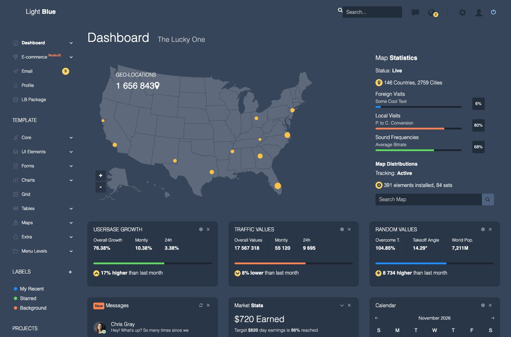

# Light Blue Angular

A free Angular dashboard with a transparent Bootstrap theme. Explore the Visits and Analytics dashboards, interactive charts, calendars, forms, sortable tables and ecommerce screens. Run it as a standalone demo or connect it to a Node.js API.

[Live demo](https://flatlogic.com/templates/light-blue-angular/demo) · [Download the latest release](https://github.com/flatlogic/light-blue-angular/releases/latest) · [Changelog](changelog.md)



## Run the demo

Use Node.js 22.13 or later on the 22.x line, or Node.js 24 or later. The repository includes an npm lockfile.

```sh
git clone https://github.com/flatlogic/light-blue-angular.git
cd light-blue-angular
npm ci
npm start
```

Open [localhost:3000](http://localhost:3000/) and choose **Login** with the prefilled demo credentials. This mode uses sample data and stores the demo session in your browser. Log out from the navigation bar to clear it.

| Command | Purpose |
| --- | --- |
| `npm run build:demo` | Build the standalone demo for static hosting |
| `npm run start:backend` | Run the frontend against a local API |
| `npm run build` | Build the production frontend with API sign-in |
| `npm test` | Run the Angular session tests |
| `npm run lint` | Check the TypeScript sources with ESLint |

Both production builds write files to `dist/`. Deploy that directory to a static server. When hosting under a subdirectory, pass its path to the build, for example `npm run build:demo -- --base-href /dashboard/`. The app uses hash-based routes.

## Connect an API

Start the [Flatlogic Node.js backend](https://github.com/flatlogic/nodejs-backend) with a development database and a test account, then run `npm run start:backend`. The frontend uses `http://localhost:8080/api` in development and `/api` on the frontend's origin in production. Set the `content` of the `light-blue-api` meta tag in `index.html` to use a different API base URL. A cross-origin API must allow the frontend origin.

The companion backend exposes `POST /auth/signin/local` and `POST /auth/signup` under its API base. Sign-in accepts the backend's plain-text JWT and the older JSON response with a `token` field. If your existing installation serves those routes under `/user`, set `authPath` in [app.config.ts](src/app/app.config.ts) to `/user`. Social login also requires provider configuration on your backend.

## Upgrading from 7.x

Switch to a supported Node.js version and install with `npm ci`. Version 8 uses Angular 21 LTS, the Angular application builder and TypeScript 5.9. The static and API builds are separate commands. Existing deployments that used a remote API should set their API base URL when publishing the new build.

## Project links

[Source code](https://github.com/flatlogic/light-blue-angular) · [Flatlogic community](https://discord.gg/flatlogic-community) · [MIT license](LICENSE)
